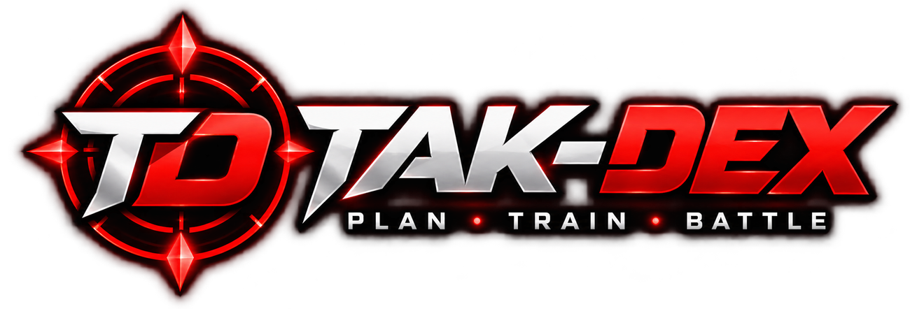

<div align="center">
  

  # Tak-Dex

  **Plan · Train · Battle**

  [Open Tak-Dex](https://alexandrestp337.github.io/Tak-Dex/) · [GitHub repository](https://github.com/alexandrestp337/Tak-Dex)
</div>

A Pokémon companion for team building, battle planning, moves, Pokédex lookup, and location reference. The web version runs in a browser; the same web assets can be packaged into an Android app using Capacitor.

> **Status:** V73 DEV5 development build. Do not merge into `main` until tested and approved. This ZIP contains website replacement files, **not** a signed Android APK. The published GitHub Pages app may still be on an earlier release.

## Features

| Tool | What it does |
| --- | --- |
| Team Builder | Save teams by game, choose moves, see type and move information, expand Pokémon cards, evolve, duplicate, import or export teams. |
| Battle | Select opponents, analyze single/double matchups, identify recommended team Pokémon and attacks; tap a Pokémon to view Pokédex, hold to compare. |
| 6v6 Battle Planner | Compare a saved or custom team with League, Gym Leader, Champion and other trainer rosters where available. Edit levels, moves and known abilities. Loaded lineups survive switching tabs. |
| Pokédex | Search Pokémon, inspect types, base stats, evolution, moves and game-specific information. The search controls collapse when navigating in from Battle. |
| Pokémon Comparison | Side-by-side Pokémon stats and matchups. |
| Move Checker | Move power, accuracy, PP, history by generation, game-specific methods, tutor acquisition and your loaded team's compatibility. |
| TM/HM Compatibility | Check move compatibility with an individual Pokémon or saved team. |
| Interactive Maps | Sinnoh map for **Platinum** (other map records are retained for later). Select town, route, gym or landmark pins and browse the synchronized list. Automatically zoom to selections or a destination linked from Move Checker. |
| Offline Data | Download and manage local game data and artwork packs. |

## What's new in V73 DEV5

- **More menu:** Interactive Maps is now directly above **Offline Data**.
- **Cleaner app:** Removed unnecessary map disclaimers and several non-actionable explanation paragraphs throughout the interface.
- **Roads:** Removed inaccurate drawn road highlights. Routes remain selectable by their map points or the location list, with list synchronization and zoom.
- **Move Tutors → Move Checker:** Tap any move in a map location's Move Tutor list to open that move in Move Checker for Platinum. **Back** returns to the selected map location.
- **Gym badges → 6v6:** Choose an on-map Gym/Badge and press **Open in 6v6 Battle**. Loads the game-specific Gym Leader opponent roster at its actual levels, retains the user's existing Platinum 6v6 team, and returns to the selected map when going back.
- **Map header:** Removed duplicate Region selector and unnecessary explanatory footer text.
- **Maps UX (earlier V73 previews):** Map/list two-way selection; auto zoom and pan; generated HD in-game-style Sinnoh map, towns, gym badges, Newmoon Island, Fullmoon Island, Great Marsh, Pal Park and other locations.
- **Battle UX (earlier V73 previews):** Tap/hold Pokémon interactions, saved 6v6 state when changing screens, collapsible Pokédex selection controls, and red Android tap-highlight styling.

### Supported games

34 selections spanning Red, Blue, Yellow, Gold, Silver, Crystal, Ruby, Sapphire, Emerald, FireRed, LeafGreen, Diamond, Pearl, Platinum, HeartGold, SoulSilver, Black, White, Black 2, White 2, X, Y, Omega Ruby, Alpha Sapphire, Sun, Moon, Ultra Sun, Ultra Moon, Sword, Shield, Brilliant Diamond, Shining Pearl, Scarlet and Violet.

Only **Platinum** is currently exposed in Maps. This restriction does not apply to the other tools. Some game-specific records are incomplete; Tak-Dex does not invent missing learnsets or trainer moves.

## Local setup

The website is plain HTML, CSS and JavaScript. Serve it over HTTP, for example:

```bash
python -m http.server 8000
```

Open `http://localhost:8000` in a browser. Test replacement files on your **Development** branch first, then merge and tag a stable release only when you're satisfied.

### Files

```text
index.html                     App screens and navigation
app.js                         Team, battle, 6v6, Pokédex and Move Checker
styles.css                     Layout and interaction styling
maps.js                        Platinum map, pins, gym and tutor shortcuts
v73-ui.js                      Battle-to-Pokédex/Comparison interactions
tutor-locations.js             Tutor locations and shard costs
sinnoh-platinum-game-map.png   Bundled 3000 × 3000 Sinnoh image
sw.js                          Offline app-shell cache
README.md                      Project documentation
```

### Android

Build through Capacitor and Android Studio using the same Android package ID (`io.github.alexandrestp337.takdex`) and original release signing key if updating an existing installation. Do not publish your signing key, passwords or other secrets. After replacing the web assets in the configured `webDir`, synchronize with `npx cap sync android` and build/sign a new APK.

## Sources and credits

- [PokéAPI](https://pokeapi.co/) supplies Pokémon, moves and some location reference data.
- [Pokémon Database – Platinum Gym Leaders](https://pokemondb.net/platinum/gymleaders-elitefour) documents Platinum's original and rematch Gym teams.
- [Serebii Platinum Move Tutors](https://www.serebii.net/platinum/movetutors.shtml) and other curated game references support Move Tutor locations and costs.
- The Sinnoh image is a generated **game-style recreation** based on a low-resolution in-game map reference; it is not a pixel-exact official Nintendo map. Pokémon names and imagery belong to their respective rights holders.

Tak-Dex is an independent fan-made companion, not affiliated with Nintendo, Game Freak or The Pokémon Company. To report a bug or request a feature, use [GitHub Issues](https://github.com/alexandrestp337/Tak-Dex/issues).
